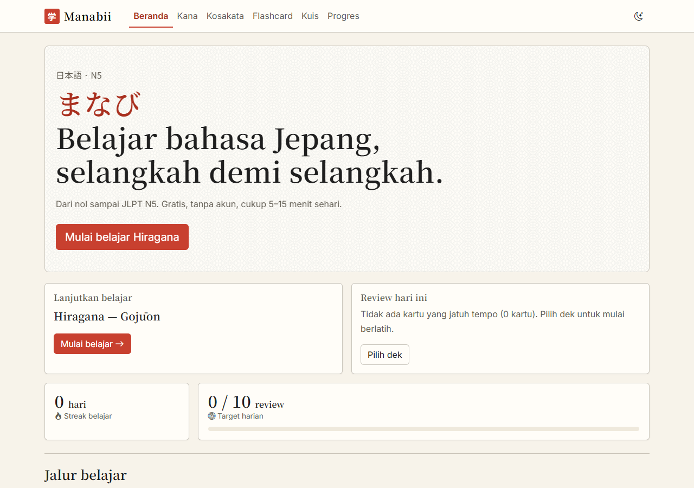
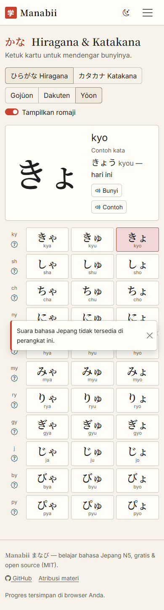
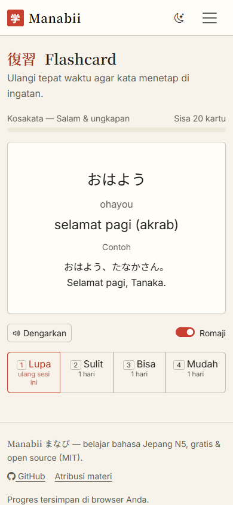
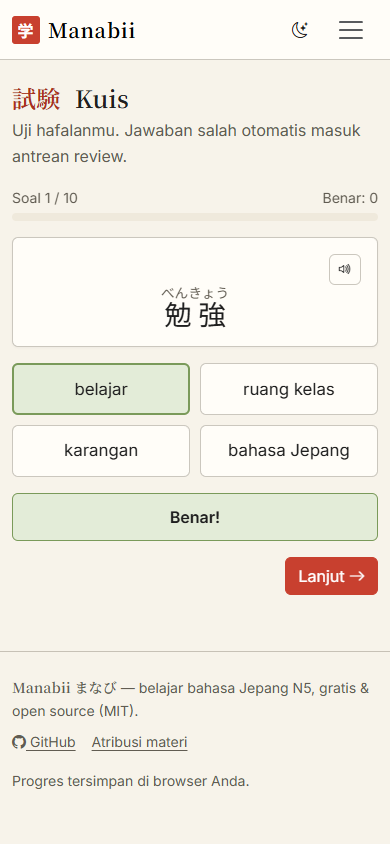

# Manabii (まなび)

Website gratis dan open source untuk belajar bahasa Jepang dari nol sampai **JLPT N5**, untuk pengguna berbahasa Indonesia.

Jalur belajar: Hiragana → Katakana → Kosakata → Kanji dasar → Tata bahasa N5.
Tanpa akun; progres disimpan di `localStorage` browser. Dibangun dengan **Next.js (App Router, static export)**, React, JavaScript, dan Bootstrap 5.3; hasilnya situs statis untuk GitHub Pages.

> Status: **v1.2** — Kana (+ animasi goresan), Kanji N5, Kosakata (±800 kata), Tata bahasa N5, Flashcard SRS, Kuis (pilihan ganda/ketik/mendengar), Progres, PWA offline, dan pengingat belajar.

## Tampilan

| Beranda                                  | Kana                                      | Flashcard                                           | Kuis                                      |
| ---------------------------------------- | ----------------------------------------- | --------------------------------------------------- | ----------------------------------------- |
|  |  |  |  |

## Menjalankan secara lokal

Butuh Node.js 20+.

```bash
npm install
npm run dev        # http://localhost:3000
```

Build statis (hasil di `out/`, memakai basePath `/learn-japanese`):

```bash
npm run build      # next build + daftar precache service worker
npm start          # pratinjau out/ di http://localhost:3000/learn-japanese/ (sama seperti GitHub Pages)
```

## Tes & validasi data

Tes logika murni tidak membutuhkan dependensi tambahan:

```bash
npm run lint                     # ESLint
node --test                      # tes SRS, romaji, statistik, mesin kuis, pengingat, dan data
node scripts/validate-data.mjs   # validasi data/*.json terhadap data/schema/*.json (+ goresan SVG)
npx playwright install           # sekali saja: Chromium, Firefox, WebKit
npm run build && npm run test:e2e   # tes end-to-end lintas browser (juga emulasi Android & iPhone)
npm run review-report            # daftar materi yang belum ditinjau penutur asli
```

## Struktur folder

```
src/app/         rute App Router (/, /kana, /kosakata, /flashcard, /kuis, /progres, not-found)
src/features/    satu komponen client per halaman
src/components/  Navbar, Footer, ToastHost, ThemeSync, dll.
src/lib/         logika murni (srs, romaji, stats, quiz-engine) + storage, tts, data, hooks
src/styles/      theme.css (design tokens + override Bootstrap), components.css
data/            hiragana, katakana, vocab-n5, themes (+ schema/)
public/          og-image.svg
scripts/         validate-data, postbuild-sw (precache), preview-server, review-report, mark-reviewed
tests/           tes `node --test`
e2e/             tes Playwright lintas browser
public/          sw.js, icons/, og-image.svg
.github/         workflow validasi data & deploy GitHub Pages, template issue
```

## Berkontribusi

Lihat [CONTRIBUTING.md](CONTRIBUTING.md). Atribusi materi pihak ketiga ada di [ATTRIBUTION.md](ATTRIBUTION.md).

## Lisensi

Kode: [MIT](LICENSE).

## Catatan keputusan

Keputusan yang tidak tercakup di `context.md` dan dipilih seperti berikut (opsi paling sederhana):

- **Prototipe lama dihapus.** Repo sebelumnya berisi satu halaman statis ("Belajar Nippon"); diganti total oleh struktur Manabii. Versi lama tetap ada di riwayat git.
- **Migrasi ke Next.js (v1.1):** App Router dengan `output: 'export'` + JavaScript. Navbar/footer kini komponen React yang ikut di-prerender (tanpa layout shift). `react-bootstrap` dipakai untuk Modal/Offcanvas/Toast agar tidak mengelola JS Bootstrap manual.
- **Base URL:** `https://syahreza-satria.github.io/learn-japanese/` ada di `src/lib/config.js` (dipakai untuk canonical, Open Graph, sitemap, robots) dan `basePath` di `next.config.mjs`; ganti keduanya saat domain final ditentukan.
- **Tema kosakata** disimpan di `data/themes.json` (label, ikon, deskripsi) agar materi tetap hanya ada di folder `data/`.
- **Kana:** `ん` berada di baris `nn` (bukan `n`, yang dipakai baris な). `ぢ/づ` (romaji `ji`/`zu`) punya `alt` (`di`/`du`), dan `を` punya `alt` `o` untuk jawaban ketik. Pada mode romaji→kana, kana yang romajinya ambigu (じ/ぢ, ず/づ) tidak dijadikan soal.
- **Romaji vokal panjang** ditulis sesuai kana (`ou`, `oo`, `uu`), bukan makron, supaya mudah diketik.
- **Item SRS dibuat saat pertama kali dinilai**, ditambahkan dari Kosakata ("Tambahkan ke flashcard"), atau saat salah menjawab kuis. Dek Hiragana/Katakana/Kosakata menampilkan item baru dan yang jatuh tempo.
- **`reviewed: false`** ditandai pada seluruh entri kosakata: materi belum ditinjau penutur asli/guru. Koreksi sangat diharapkan.
- **Skrip kecil di `<head>`** (inline, di `layout.js`) menerapkan `data-bs-theme` sebelum render dan menyisipkan CSS Google Fonts secara non-blocking.
- **TTS cadangan online:** bila perangkat tak punya voice Jepang, `tts.js` memutar audio dari endpoint `translate.google.com/translate_tts` (tidak resmi: bisa berubah atau dibatasi sewaktu-waktu, dan teks materi yang dibacakan dikirim ke Google). Voice bawaan perangkat tetap diprioritaskan; untuk TTS yang stabil, ganti dengan layanan resmi berkunci atau berkas audio.
- **Efek suara kuis** (benar, salah/waktu habis, selesai) disintesis dengan Web Audio API di `src/lib/sfx.js`, tanpa berkas audio; bisa dimatikan di setup kuis, saat kuis berjalan, atau di Progres.
- **PWA offline:** `public/sw.js` melakukan precache seluruh situs (daftar dibuat `scripts/postbuild-sw.mjs`); halaman memakai strategi jaringan-dulu dengan cadangan cache. Suara cadangan online tentu tidak tersedia offline.
- **Pengingat belajar:** web statis tanpa server push tidak bisa menjadwalkan notifikasi saat aplikasi tertutup. Karena itu pengingat = banner dalam aplikasi (kartu jatuh tempo) + notifikasi browser bila Manabii sedang terbuka/terpasang dan sudah lewat jam pengingat.
- **Kanji & goresan:** data goresan berasal dari KanjiVG (CC BY-SA 3.0) dan disimpan di `data/strokes.json`; berkas itu mengikuti lisensi aslinya (lihat ATTRIBUTION.md). 95 kanji dipilih mengikuti daftar umum N5, bukan daftar resmi.
- **Tata bahasa:** latihan berupa isian pilihan ganda (satu jawaban benar) agar bisa dinilai otomatis tanpa ambiguitas.
- **TTS online dapat diganti:** setel `NEXT_PUBLIC_TTS_URL` (template dengan `{text}`) saat build untuk memakai proxy/layanan resmi sendiri.
- **Data materi di-import dinamis** (`import()` JSON) sehingga ikut code-splitting per halaman; `Link` memakai `prefetch={false}` karena prefetch RSC pada static export menghasilkan 404 di console.
- **Kartu baru flashcard dibatasi 20 per sesi** agar sesi tetap 5–15 menit; bila tidak ada kartu jatuh tempo tersedia tombol "Latih tetap" (maks. 30 kartu acak, penilaian tetap memperbarui SRS).
- **Impor data menimpa seluruh data** setelah konfirmasi, dan hanya menerima cadangan Manabii versi ≤ 1.
- **og-image berformat SVG** sesuai rencana; sebagian platform sosial hanya menampilkan PNG/JPG, jadi ganti bila pratinjau tidak muncul.
